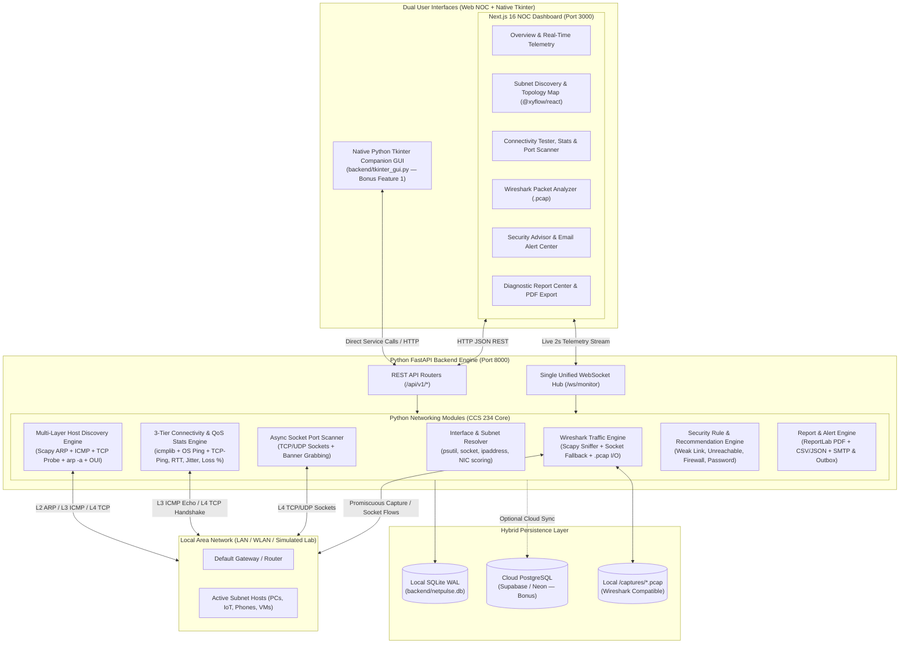

# 01 — Technology Stack & System Architecture

## 1. Architectural Decision: Python FastAPI + Next.js 16 NOC + Native Tkinter Companion

The CCS 234 syllabus explicitly evaluates **Python Network Programming**, **Socket Programming**, **OSI/TCP-IP Protocol Implementation**, and **Wireshark Traffic Analysis** (20 points Technical Implementation + 30 points Functionality), while also grading **User Interface and Design** (10 points) and **Innovation & Creativity** (5 points, listing *"GUI using Tkinter"*, *"Dashboard Charts"*, *"Export to PDF"*, *"Email Notification"*, *"Port Scanner"*, *"Wireshark Packet Integration"*, *"Real-time Monitoring"*, and *"Cloud Database Storage"*).

To ensure **zero compromises** and **100% rubric compliance**:
1. **Backend (`backend/app/`)**: 100% **Python 3.11+** powered by **FastAPI**, raw/stream `socket`, `scapy`, `icmplib`, `psutil`, and `SQLModel`. Every networking operation (ARP discovery, ICMP/TCP ping, socket port scanning, packet sniffing, `.pcap` parsing/generation, security rule evaluation, PDF generation, and SMTP alerts) is written in clean, well-commented Python.
2. **Primary Web NOC Frontend (`src/`)**: **Next.js 16.4 (App Router, TypeScript)** using **Tailwind CSS v4**, **shadcn/ui**, **Tremor / Recharts**, and **React Flow (`@xyflow/react`)** to deliver an enterprise **NOC (Network Operations Center) / SOC (Security Operations Center)** real-time web dashboard.
3. **Native Python Tkinter Companion GUI (`backend/tkinter_gui.py`)**: A dark-themed Python **Tkinter (`ttk`)** desktop application that shares the exact same `backend/app/services/` Python modules. It allows the user or professor to run Network Discovery, Ping Tests, Port Scans, and PDF Report exports directly in a native Tkinter window OR launch/monitor the Next.js Web NOC Dashboard with one click!

---

## 2. Complete Industry-Standard Technology Stack

### 2.1 Backend & Native GUI Stack (Python Network & Telemetry Engine)

| Category | Technology / Library | Purpose in NetPulse NOC |
| :--- | :--- | :--- |
| **Runtime & Package Manager** | **Python 3.11+** + **`venv` / `pip`** | Reproducible Python environment management (`backend/.venv`) |
| **API & WebSocket Server** | **FastAPI** + **Uvicorn (`standard`)** | High-performance async REST API + bidirectional WebSockets (`/ws/monitor`) |
| **Native Desktop GUI (Bonus)** | **Python `tkinter` & `tkinter.ttk` (Stdlib)** | Native Cyber-NOC dark-themed Tkinter desktop GUI & launcher (`backend/tkinter_gui.py`) |
| **Layer 2/3/4 Packet Engine** | **Scapy (`scapy`)** (+ **Npcap** when available) | ARP broadcast host discovery, live packet sniffing, BPF filtering, and reading/writing Wireshark `.pcap` files |
| **Socket & DNS Programming** | **Python `socket` & `asyncio` (Stdlib)** | Raw/stream TCP & UDP port scanning, service banner grabbing, reverse DNS hostname lookup (`gethostbyaddr`), local IP detection |
| **Subnet & CIDR Calculation** | **Python `ipaddress` (Stdlib)** | IPv4Network subnet mask calculation, usable host enumeration, `/24` safety slicing on large networks |
| **ICMP & Fallback Ping Engine** | **`icmplib`** + Native `ping` + TCP Handshake fallback | Non-blocking, multi-host concurrent Echo Request/Reply with exact Min/Avg/Max RTT, Jitter, and Packet Loss % |
| **NIC & Bandwidth Metrics** | **`psutil`** | Enumerating active network interfaces (Wi-Fi, Ethernet), MAC addresses, subnet masks, active sockets, and real-time TX/RX throughput |
| **MAC Vendor Lookup** | **Embedded IEEE OUI Table + `mac-vendor-lookup`** | 100% offline-capable resolution of MAC prefixes (`00:1A:2B` -> `Cisco`, `Apple`, `Intel`, `TP-Link`, `Realtek`, etc.) |
| **Database & ORM (Local + Cloud)** | **SQLModel** (`SQLAlchemy` + `Pydantic v2`) + `psycopg2-binary` | Type-safe ORM supporting **SQLite WAL** (`netpulse.db`) out-of-the-box and **Cloud PostgreSQL (Supabase / Neon)** via `DATABASE_URL` |
| **PDF Report Generator (Bonus)** | **`ReportLab`** (`platypus`) | Pure-Python generation of multi-page, styled Diagnostic & Security Audit PDF reports (zero external OS binary dependencies) |
| **Email Alerting (Bonus)** | **`aiosmtplib`** + **`email.message`** + Local Outbox | Async SMTP client (Gmail App Password / Mailtrap / Custom SMTP) plus a built-in **Local Outbox Preview** for offline demos |
| **Testing Framework** | **`pytest`** + **`pytest-asyncio`** + **`httpx`** | Automated unit and integration testing of discovery, ping statistics, port scanner, `.pcap` engine, security advisor, and PDF export |

---

### 2.2 Frontend Stack (Next.js 16 Real-Time NOC Dashboard)

| Category | Technology / Library | Purpose in NetPulse NOC |
| :--- | :--- | :--- |
| **Framework** | **Next.js 16.4 (App Router)** + **React 19.3** + **TypeScript** | Type-safe, modular frontend architecture (already initialized in workspace root; adheres to `AGENTS.md` Next.js rules) |
| **Styling System** | **Tailwind CSS v4** (`@tailwindcss/turbopack`) + **`clsx`** + **`tailwind-merge`** | Utility-first styling configured with the dark-first Cyber-NOC color palette |
| **UI Component System** | **`shadcn/ui`** (Radix UI primitives) | Accessible enterprise components (`DataTable`, `Dialog`, `Tabs`, `Badge`, `Sheet`, `Card`, `Command`, `Select`, `Sonner` toasts) |
| **Dashboard Template Base** | **`satnaing/shadcn-admin`** + **Tremor Raw blocks** | Open-source Admin/NOC sidebar layout, KPI metric cards, command palette, and telemetry data tables |
| **Telemetry Charts (Bonus)** | **Recharts** | Real-time RTT latency area charts, packet loss radial gauges, bandwidth throughput charts, OSI protocol breakdown donut charts |
| **Network Topology Map** | **React Flow (`@xyflow/react`)** | Interactive visual node-link topology diagram showing Local Host -> Gateway Router -> Discovered Subnet Devices with color-coded latency links |
| **Data Fetching & State** | **TanStack Query (`@tanstack/react-query`)** + **Zustand** | Server state caching, scan job mutations, and real-time WebSocket telemetry store |
| **Data Tables** | **TanStack Table (`@tanstack/react-table`)** | Sortable, filterable, paginated tables for Device Inventory, Ping Statistics, Port Scan Results, and Captured Wireshark Packets |
| **Icons & Typography** | **`lucide-react`** + **Offline-Safe Monospace Stack** | Crisp technical iconography and tabular monospace fonts (`tabular-nums`) for IP addresses, MAC addresses, ports, and packet hex views |

---

## 3. System Architecture & Data Flow Diagram



---

## 4. Unified SQLModel Database Schema & API Contracts

To prevent any naming inconsistencies between the Python backend and TypeScript frontend, all modules MUST strictly adhere to the following canonical models and endpoints:

### 4.1 Canonical SQLModel Tables (`backend/app/models/`)

1. **`ScanSession` (`models/device.py`)**:
   - `id`: `int | None` (PK)
   - `started_at`, `completed_at`: `datetime`
   - `interface_name`: `str`
   - `local_ip`: `str`
   - `subnet_cidr`: `str`
   - `scan_mode`: `str` (`"HYBRID"` | `"ARP"` | `"ICMP"` | `"SIMULATION"`)
   - `total_hosts_scanned`: `int`
   - `active_hosts_found`: `int`

2. **`DiscoveredDevice` (`models/device.py`)**:
   - `id`: `int | None` (PK)
   - `ip_address`: `str` (Indexed, Unique)
   - `mac_address`: `str` (Default `"00:00:00:00:00:00"`)
   - `hostname`: `str` (Resolved DNS/NetBIOS or fallback e.g. `"Host-192-168-1-10"`)
   - `vendor`: `str` (Resolved OUI vendor or `"Unknown Vendor"`)
   - `os_guess`: `str` (Heuristic from TTL/Ports/Vendor, e.g., `"Windows"`, `"Linux/Android"`, `"Network Appliance"`)
   - `interface_name`: `str`
   - `subnet_cidr`: `str`
   - `is_online`: `bool`
   - `is_gateway`: `bool`
   - `is_local_host`: `bool`
   - `discovery_method`: `str` (`"ARP_L2"`, `"ICMP_L3"`, `"TCP_L4"`, `"ARP_CACHE"`, `"SIMULATED"`)
   - `last_rtt_ms`: `float | None`
   - `open_ports_summary`: `str` (Comma-separated open ports e.g. `"80, 443"`)
   - `first_seen`, `last_seen`: `datetime`

3. **`PingSample` & `HostQoSStats` (`models/telemetry.py`)**:
   - **`PingSample`** (Individual ping sequence record): `id`, `ip_address`, `seq`, `rtt_ms`, `ttl`, `status` (`"SUCCESS"` | `"TIMEOUT"` | `"ERROR"`), `protocol` (`"ICMP"` | `"TCP"`), `timestamp`.
   - **`HostQoSStats`** (Feature 3 Aggregate Statistics per host):
     - `id`: `int | None` (PK)
     - `ip_address`: `str` (Indexed, Unique)
     - `hostname`: `str`
     - `packets_sent`: `int`
     - `packets_received`: `int`
     - `packet_loss_pct`: `float` (`0.0` to `100.0`)
     - `min_latency_ms`: `float`
     - `avg_latency_ms`: `float`
     - `max_latency_ms`: `float`
     - `jitter_ms`: `float`
     - `last_ttl`: `int | None`
     - `ping_method`: `str` (`"ICMP"` | `"OS_PING"` | `"TCP_PING"`)
     - `updated_at`: `datetime`

4. **`PortScanResult` (`models/telemetry.py`)**:
   - `id`: `int | None` (PK)
   - `ip_address`: `str` (Indexed)
   - `port`: `int`
   - `protocol`: `str` (`"TCP"` | `"UDP"`)
   - `state`: `str` (`"OPEN"` | `"CLOSED"` | `"FILTERED"`)
   - `service_name`: `str` (e.g., `"HTTP"`, `"SSH"`, `"SMB"`, `"Telnet"`)
   - `banner`: `str` (Grabbed service banner or `""`)
   - `osi_layer`: `str` (`"Layer 4 (Transport) / Layer 7 (Application)"`)
   - `risk_level`: `str` (`"CRITICAL"` | `"HIGH"` | `"MEDIUM"` | `"LOW"`)
   - `scanned_at`: `datetime`

5. **`PcapCaptureSession` (`models/packet.py`)**:
   - `id`: `int | None` (PK)
   - `filename`: `str`
   - `file_path`: `str`
   - `interface_name`: `str`
   - `bpf_filter`: `str`
   - `packet_count`: `int`
   - `capture_source`: `str` (`"LIVE_SCAPY"` | `"LIVE_SOCKET_FALLBACK"` | `"UPLOADED_PCAP"` | `"DEMO_PCAP"`)
   - `protocol_breakdown_json`: `str` (JSON map e.g. `{"TCP": 42, "UDP": 18, "ARP": 10, "ICMP": 8}`)
   - `created_at`: `datetime`

6. **`SecurityAlert`, `DiagnosticReport`, & `EmailAlertLog` (`models/security.py`)**:
   - **`SecurityAlert`** (Feature 5): `id`, `category` (`"CONNECTIVITY"` | `"AVAILABILITY"` | `"FIREWALL"` | `"AUTHENTICATION"`), `severity` (`"CRITICAL"` | `"HIGH"` | `"MEDIUM"` | `"LOW"`), `target_ip`, `hostname`, `title`, `description`, `recommendation`, `remediation_command`, `is_resolved`, `created_at`.
   - **`DiagnosticReport`** (Feature 4 & Bonus PDF): `id`, `created_at`, `title`, `interface_name`, `local_ip`, `subnet_cidr`, `gateway_ip`, `total_devices`, `online_devices`, `avg_subnet_latency_ms`, `max_subnet_latency_ms`, `overall_packet_loss_pct`, `health_score`, `security_grade`, `summary_text`, `report_payload_json`, `pdf_path`.
   - **`EmailAlertLog`** (Bonus Email Notification & Local Outbox): `id`, `recipient_email`, `subject`, `body_preview`, `alert_category`, `delivery_mode` (`"SMTP_SENT"` | `"LOCAL_OUTBOX_SIMULATED"` | `"FAILED"`), `created_at`.

---

### 4.2 Canonical REST API & WebSocket Endpoints

| Router | Method & Path | Description |
| :--- | :--- | :--- |
| **System & DB** | `GET /api/v1/health` | Returns backend status, active DB mode (`SQLite` vs `Cloud PostgreSQL`), Npcap status, and active WS clients |
| | `POST /api/v1/system/database-mode` | Test or switch between Local SQLite and Cloud PostgreSQL (`DATABASE_URL`) |
| **Discovery (`Feature 1`)** | `GET /api/v1/discovery/interfaces` | Lists all network interfaces, scores them, and returns the active Local IP, Netmask, Gateway, MAC, and CIDR range |
| | `POST /api/v1/discovery/scan` | Runs subnet discovery (`cidr`, `interface`, `scan_mode`: `auto` \| `arp` \| `icmp` \| `simulation`), saves `DiscoveredDevice` rows, and returns devices + scan summary |
| | `GET /api/v1/discovery/devices` | Returns all discovered devices with their latest RTT and open port badges |
| **Connectivity (`Features 2, 3 & Port Bonus`)** | `POST /api/v1/connectivity/ping` | Pings one or multiple IPs (`targets`, `count`, `packet_size`, `protocol`), streams replies via WS, updates `HostQoSStats`, and returns per-host statistics |
| | `GET /api/v1/connectivity/stats` | Returns the **Feature 3 Network Statistics Table** (`hostname`, `ip_address`, `min_latency_ms`, `avg_latency_ms`, `max_latency_ms`, `jitter_ms`, `packet_loss_pct`) |
| | `POST /api/v1/connectivity/ports/scan` | Runs async TCP/UDP socket port scanner on `target_ip` (`preset`: `quick` \| `standard` \| `custom`, `ports`), grabs banners, and persists `PortScanResult` |
| | `GET /api/v1/connectivity/ports/{ip}` | Returns persisted port scan results for a specific host |
| **Packets (`Wireshark Bonus`)** | `POST /api/v1/packets/capture` | Captures live packets (`interface`, `bpf_filter`, `count`, `timeout`) via Scapy or live socket fallback, saves `.pcap`, and returns dissected OSI Layer 2–7 packets |
| | `POST /api/v1/packets/upload` | Uploads a `.pcap` / `.pcapng` file from Wireshark and dissects all packets |
| | `GET /api/v1/packets/sessions` | Lists available capture sessions (including bundled `demo_lan_traffic.pcap`) |
| | `GET /api/v1/packets/sessions/{id}` | Loads packet list, OSI dissection tree, hex dump, and protocol stats for a session |
| | `GET /api/v1/packets/sessions/{id}/download` | Downloads the raw `.pcap` file (`application/vnd.tcpdump.pcap`) for Wireshark |
| | `POST /api/v1/packets/sessions/{id}/open-wireshark` | Launches desktop `Wireshark.exe` directly with the selected `.pcap` file (if installed on Windows) |
| **Security (`Feature 5 & Email Bonus`)** | `POST /api/v1/security/evaluate` | Runs the deterministic rule engine across all devices, ping stats, and open ports; returns security score (`0–100`), grade, and categorized `SecurityAlert` items |
| | `GET /api/v1/security/recommendations` | Returns current security recommendations across all 4 required categories |
| | `POST /api/v1/security/alerts/email` | Dispatches an alert email via SMTP (or saves to Local Outbox if offline/unconfigured) |
| | `GET /api/v1/security/alerts/outbox` | Returns sent and simulated emails in the Local Outbox for live verification |
| **Reports (`Feature 4 & PDF Bonus`)** | `POST /api/v1/reports/generate` | Generates a full `DiagnosticReport` snapshot + builds the styled `ReportLab` PDF file |
| | `GET /api/v1/reports` | Lists all generated diagnostic reports |
| | `GET /api/v1/reports/{id}` | Returns full structured JSON report for on-screen preview |
| | `GET /api/v1/reports/{id}/pdf` | Downloads the styled multi-page PDF report (`application/pdf`) |
| | `GET /api/v1/reports/{id}/csv` | Exports host discovery & ping statistics as CSV |
| **WebSocket (`Real-Time Bonus`)** | `WS /ws/monitor` | Unified real-time stream broadcasting `telemetry_tick` (NIC TX/RX bps + rolling host pings), `scan_progress`, `ping_reply`, `packet_captured`, and `security_alert` |

---

## 5. Target Monorepo Directory Structure

```text
sir-orly/
├── .agents/
│   └── skills/                                # Agentic Development Skills (SKILL.md)
│       ├── netpulse-backend-core/
│       ├── network-discovery-and-arp/
│       ├── connectivity-and-stats-engine/
│       ├── wireshark-pcap-analyzer/
│       ├── security-advisor-and-reports/
│       ├── noc-dashboard-ui/
│       └── network-qa-and-verification/
├── implementation-plan/                       # Master Architecture & Checklists
│   ├── README.md
│   ├── 01-TECH-STACK-AND-ARCHITECTURE.md
│   ├── 02-UI-THEME-AND-TEMPLATE-GUIDE.md
│   ├── 03-STEP-BY-STEP-IMPLEMENTATION-CHECKLIST.md
│   └── 04-AGENTIC-SKILLS-WORKFLOW.md
├── backend/                                   # Python FastAPI Networking Engine + Tkinter GUI
│   ├── app/
│   │   ├── __init__.py
│   │   ├── main.py                            # FastAPI entry point, CORS, /ws/monitor mount
│   │   ├── config.py                          # Env settings (SQLite/Postgres DB URL, SMTP, timeouts)
│   │   ├── database.py                        # SQLite WAL + Cloud PostgreSQL SQLModel engine
│   │   ├── models/                            # SQLModel DB Tables & Pydantic Schemas
│   │   │   ├── __init__.py
│   │   │   ├── device.py                      # ScanSession, DiscoveredDevice
│   │   │   ├── telemetry.py                   # PingSample, HostQoSStats, PortScanResult
│   │   │   ├── packet.py                      # PcapCaptureSession, PacketDissectionSchema
│   │   │   └── security.py                    # SecurityAlert, DiagnosticReport, EmailAlertLog
│   │   ├── services/                          # Core Python Networking Engines
│   │   │   ├── __init__.py
│   │   │   ├── interface_detector.py          # Feature 1a: Smart NIC scorer, Local IP, CIDR, Gateway
│   │   │   ├── oui_lookup.py                  # Offline IEEE OUI MAC vendor dictionary
│   │   │   ├── network_scanner.py             # Feature 1b: ARP + ICMP + TCP + arp -a + Lab Simulator
│   │   │   ├── ping_engine.py                 # Features 2 & 3: 3-tier Ping, RTT, Jitter, Loss%
│   │   │   ├── port_scanner.py                # Bonus: Async Socket TCP/UDP Scanner + Banners
│   │   │   ├── packet_analyzer.py             # Topic 7 & Bonus: Scapy Sniffer + Socket Fallback + .pcap
│   │   │   ├── security_advisor.py            # Feature 5: 4-Category Security Rule Engine
│   │   │   ├── report_generator.py            # Feature 4 & Bonus: ReportLab PDF, CSV, JSON
│   │   │   ├── email_notifier.py              # Bonus: Async SMTP + Offline Outbox Mailbox
│   │   │   └── ws_manager.py                  # Bonus: Real-Time Monitoring Loop & WS Broadcast
│   │   └── routers/                           # FastAPI Modular Endpoints (/api/v1/*)
│   │       ├── __init__.py
│   │       ├── discovery.py
│   │       ├── connectivity.py
│   │       ├── packets.py
│   │       ├── security.py
│   │       └── reports.py
│   ├── tkinter_gui.py                         # Bonus Feature 1: Native Python Tkinter Control Center GUI
│   ├── captures/                              # Saved .pcap files + bundled demo_lan_traffic.pcap
│   ├── reports/                               # Generated PDF diagnostic reports
│   ├── tests/                                 # Automated Pytest suite for all networking modules
│   └── requirements.txt                       # Pinned Python dependencies
├── src/                                       # Next.js 16 App Router Frontend (NOC UI)
│   ├── app/
│   │   ├── layout.tsx                         # Dark NOC Shell, Sidebar, Header, Status Bar
│   │   ├── page.tsx                           # Dashboard Overview (KPIs, Live Charts, Quick Scan)
│   │   ├── discovery/page.tsx                 # Feature 1: Subnet Scanner, Device Table & Topology Map
│   │   ├── connectivity/page.tsx              # Features 2 & 3 + Bonus: Ping Tester, Stats & Port Scanner
│   │   ├── packets/page.tsx                   # Wireshark Integration: Packet Sniffer & .pcap Inspector
│   │   ├── security/page.tsx                  # Feature 5 + Bonus: Security Advisor & Email Alert Center
│   │   └── reports/page.tsx                   # Feature 4 + Bonus: Report Builder & One-Click PDF Export
│   ├── components/
│   │   ├── layout/                            # AppSidebar, TopStatusBar, NIC Switcher, Demo Seed Button
│   │   ├── dashboard/                         # KPI Stat Cards, Bandwidth Area Chart, Health Gauge
│   │   ├── discovery/                         # Subnet Controls, Device DataTable, ReactFlow Topology
│   │   ├── connectivity/                      # Ping Console, QoS Stats Table, Port Scanner Matrix
│   │   ├── packets/                           # Wireshark 3-Pane Packet List / OSI Tree / Hex View
│   │   ├── security/                          # Severity Cards, Remediation Copy, SMTP & Outbox Modal
│   │   ├── reports/                           # Interactive Report Previewer, PDF/CSV/JSON Triggers
│   │   └── ui/                                # shadcn/ui primitives
│   ├── hooks/                                 # useTelemetrySocket, useNetworkData
│   ├── lib/                                   # Typed API client, formatters, constants
│   └── store/                                 # Zustand live telemetry store
├── start-netpulse.ps1                         # One-click Windows launcher (Backend + Web UI + Tkinter)
└── package.json
```
