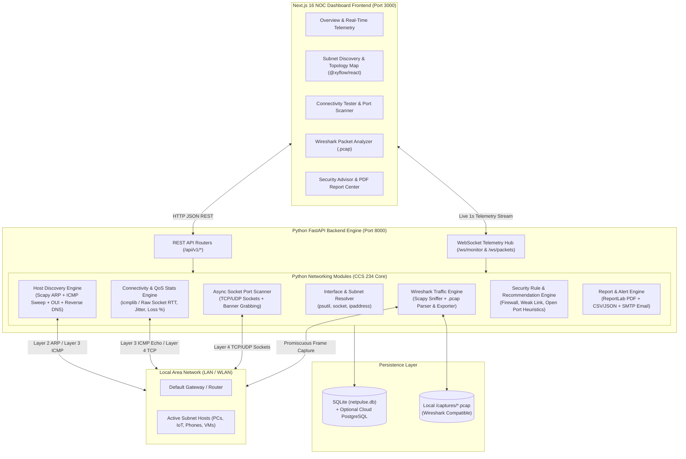

# 01 — Technology Stack & System Architecture

## 1. Architectural Decision: Why Python + Next.js Hybrid Monorepo?

The CCS 234 syllabus explicitly evaluates **Python Network Programming**, **Socket Programming**, **OSI/TCP-IP Protocol Implementation**, and **Wireshark Traffic Analysis** (20 points Technical Implementation + 30 points Functionality), while also grading **User Interface and Design** (10 points) and **Innovation & Creativity** (5 points).

- **Why Pure Next.js / Node.js Alone is Insufficient:** Browser sandboxes and Node.js cannot natively craft raw Layer 2 ARP frames, raw Layer 3 ICMP packets, or capture promiscuous network interface frames into `.pcap` files without native bindings, and the course specifically requires **Python** for networking.
- **Why Pure Python Tkinter Alone is Sub-Optimal:** While Tkinter is listed as an optional basic GUI, it looks dated, struggles with smooth 60fps real-time streaming telemetry charts, and lacks interactive network topology graphs.
- **The Industry-Standard Solution (Python FastAPI Backend + Next.js 16 Frontend):**
  - **Backend (`backend/`)**: 100% **Python 3.11+** powered by **FastAPI**, raw `socket`, `scapy`, `icmplib`, `psutil`, and `SQLModel`. Every networking operation (ARP discovery, ICMP ping, TCP/UDP port scanning, packet sniffing, `.pcap` parsing/generation) is written in clean, well-commented Python.
  - **Frontend (`src/` or `frontend/`)**: **Next.js (App Router, TypeScript)** using **Tailwind CSS**, **shadcn/ui**, **Tremor / Recharts**, and **React Flow (`@xyflow/react`)** to deliver an enterprise **NOC (Network Operations Center) / SOC (Security Operations Center)** real-time web dashboard.

---

## 2. Complete Industry-Standard Technology Stack

### 2.1 Backend Stack (Python Network & Telemetry Engine)

| Category | Technology / Library | Purpose in NetPulse NOC |
| :--- | :--- | :--- |
| **Runtime & Package Manager** | **Python 3.11+** + **`uv`** (or `pip`/`venv`) | Fast, reproducible Python environment management |
| **API & WebSocket Server** | **FastAPI** + **Uvicorn (`standard`)** | High-performance async REST API + bidirectional WebSockets (`/ws/monitor`, `/ws/packets`) |
| **Layer 2/3/4 Packet Engine** | **Scapy (`scapy`)** (+ **Npcap** on Windows) | ARP broadcast host discovery, live packet sniffing, BPF filtering, and reading/writing Wireshark `.pcap` files |
| **Socket & DNS Programming** | **Python `socket` & `asyncio` (Stdlib)** | Raw/stream TCP & UDP port scanning, service banner grabbing, reverse DNS hostname lookup (`gethostbyaddr`), local IP detection |
| **Subnet & CIDR Calculation** | **Python `ipaddress` (Stdlib)** | IPv4Network subnet mask calculation, usable host enumeration, CIDR validation |
| **ICMP Ping Engine** | **`icmplib`** (with `ping3` / subprocess / TCP ping fallback) | Non-blocking, multi-host concurrent ICMP Echo Request/Reply with exact Min/Avg/Max RTT, Jitter, and Packet Loss % |
| **NIC & Bandwidth Metrics** | **`psutil`** | Enumerating active network interfaces (Wi-Fi, Ethernet), MAC addresses, subnet masks, and real-time bytes sent/received throughput |
| **MAC Vendor Lookup** | **`mac-vendor-lookup`** (or bundled IEEE OUI JSON table) | Offline-capable resolution of MAC prefixes (e.g., `00:1A:2B` -> `Cisco Systems`, `Apple`, `Intel`) |
| **Database & ORM** | **SQLModel** (`SQLAlchemy` + `Pydantic v2`) | Type-safe ORM supporting **SQLite** (local zero-config `netpulse.db`) and **PostgreSQL / Supabase** (Cloud Database Bonus Feature) |
| **PDF Report Generator** | **`ReportLab`** (or **`fpdf2`**) | Pure-Python generation of multi-page, styled Diagnostic & Security Audit PDF reports (no external GTK binary dependencies on Windows) |
| **Email Alerting** | **`aiosmtplib`** + **`email.message`** | Async SMTP client (Gmail App Password / Mailtrap / Resend SMTP) for sending automated host-down and security alert emails |
| **Testing Framework** | **`pytest`** + **`pytest-asyncio`** + **`httpx`** | Automated unit and integration testing of discovery, ping statistics, security rule engine, and API endpoints |

> [!IMPORTANT]
> **Windows Driver Note (Wireshark / Scapy Compatibility):**  
> On Windows, raw Layer 2 ARP scanning and live packet sniffing via `scapy` use **Npcap** (which is automatically installed with **Wireshark**). The Python backend MUST also include an automatic **graceful fallback** (Async ICMP sweep + OS ARP cache table parsing via `arp -a` + TCP socket probing) so that the app works 100% reliably even on machines without Administrator privileges or Npcap!

---

### 2.2 Frontend Stack (Next.js Real-Time NOC Dashboard)

| Category | Technology / Library | Purpose in NetPulse NOC |
| :--- | :--- | :--- |
| **Framework** | **Next.js 16 (App Router)** + **React 19** + **TypeScript** | Type-safe, modular frontend architecture (already initialized in workspace root) |
| **Styling System** | **Tailwind CSS v4** + **`clsx`** + **`tailwind-merge`** | Utility-first styling configured with a dark-first Cyber-NOC color palette |
| **UI Component System** | **`shadcn/ui`** (Radix UI primitives) | Accessible, customizable enterprise components (`DataTable`, `Dialog`, `Tabs`, `Badge`, `Sheet`, `Card`, `Command`, `Sonner` toasts) |
| **Dashboard Template Base** | **`satnaing/shadcn-admin`** + **Tremor Raw blocks** | Open-source Admin/NOC sidebar layout, KPI metric cards, command palette (`Ctrl+K`), and telemetry data tables |
| **Telemetry Charts** | **Recharts** (via `shadcn/ui charts` & **Tremor**) | Real-time RTT latency line/area charts, packet loss radial gauges, OSI layer traffic distribution bar/donut charts |
| **Network Topology Map** | **React Flow (`@xyflow/react`)** | Interactive visual node-link topology diagram showing Local Host -> Gateway Router -> Discovered Subnet Devices with color-coded latency links |
| **Data Fetching & State** | **TanStack Query (`@tanstack/react-query`)** + **Zustand** | Server state caching, scan job polling, and real-time WebSocket telemetry store |
| **Data Tables** | **TanStack Table (`@tanstack/react-table`)** | Sortable, filterable, paginated tables for Device Inventory, Ping Statistics, Port Scan Results, and Captured Wireshark Packets |
| **Icons & Typography** | **`lucide-react`** + **`Geist Sans` & `Geist Mono`** | Crisp technical iconography and tabular monospace fonts for IP addresses, MAC addresses, ports, and packet hex views |

---

## 3. System Architecture & Data Flow Diagram



---

## 4. Mapping to OSI & TCP/IP Reference Models

To score **20/20 on Technical Implementation**, the application explicitly surfaces OSI and TCP/IP layer metadata in both the backend models and the UI:

| OSI Layer | TCP/IP Layer | Protocols Analyzed by NetPulse | Python Module / Implementation |
| :--- | :--- | :--- | :--- |
| **Layer 7: Application** | Application | `HTTP`, `HTTPS`, `DNS`, `SSH`, `FTP`, `Telnet`, `SMTP`, `SMB`, `RDP` | Socket Banner Grabbing, Reverse DNS (`socket.gethostbyaddr`), Service Identification |
| **Layer 4: Transport** | Transport | `TCP` (SYN/ACK, Three-Way Handshake), `UDP` | `socket.AF_INET` + `SOCK_STREAM` / `SOCK_DGRAM` Port Scanner, Scapy TCP/UDP packet dissection |
| **Layer 3: Network** | Internet | `IPv4`, `ICMP` (Echo Request Type 8 / Echo Reply Type 0), `TTL`, `CIDR` | `ipaddress.IPv4Network`, `icmplib` / raw ICMP sockets, TTL hop distance estimation |
| **Layer 2: Data Link** | Network Access | `Ethernet (IEEE 802.3 / 802.11)`, `ARP` (Who-has / Is-at), `MAC OUI` | `scapy.layers.l2.ARP` & `Ether`, OS ARP Cache (`arp -a`), IEEE OUI Vendor Resolution |
| **Layer 1: Physical** | Network Access | NIC Link Speed (Mbps), Duplex, MTU, Bytes Sent/Received | `psutil.net_if_stats()`, `psutil.net_io_counters()` |

---

## 5. Target Monorepo Directory Structure

```text
sir-orly/
├── .agents/
│   └── skills/                                # Agentic Development Skills (SKILL.md)
│       ├── netpulse-backend-core/
│       ├── network-discovery-and-arp/
│       ├── connectivity-and-stats-engine/
│       ├── wireshark-pcap-analyzer/
│       ├── security-advisor-and-reports/
│       ├── noc-dashboard-ui/
│       └── network-qa-and-verification/
├── implementation-plan/                       # THIS FOLDER: Master Architecture & Checklists
│   ├── README.md
│   ├── 01-TECH-STACK-AND-ARCHITECTURE.md
│   ├── 02-UI-THEME-AND-TEMPLATE-GUIDE.md
│   ├── 03-STEP-BY-STEP-IMPLEMENTATION-CHECKLIST.md
│   └── 04-AGENTIC-SKILLS-WORKFLOW.md
├── backend/                                   # Python FastAPI Networking Engine
│   ├── app/
│   │   ├── __init__.py
│   │   ├── main.py                            # FastAPI entry point, CORS, WebSocket mount
│   │   ├── config.py                          # Env settings (DB URL, SMTP, scan timeouts)
│   │   ├── database.py                        # SQLite / Cloud PostgreSQL SQLModel session
│   │   ├── models/                            # SQLModel DB Tables & Pydantic Schemas
│   │   │   ├── device.py                      # DiscoveredDevice, PortScanResult
│   │   │   ├── telemetry.py                   # PingRecord, HostStatistics, ScanSession
│   │   │   ├── packet.py                      # PcapSession, PacketSummary, ProtocolStat
│   │   │   └── security.py                    # SecurityRecommendation, DiagnosticReport
│   │   ├── services/                          # Core Python Networking Engines
│   │   │   ├── interface_detector.py          # Feature 1a: Local IP, CIDR, Gateway, NIC stats
│   │   │   ├── network_scanner.py             # Feature 1b: Scapy ARP + ICMP Sweep + OUI + DNS
│   │   │   ├── ping_engine.py                 # Feature 2 & 3: ICMP/TCP Ping, RTT, Jitter, Loss%
│   │   │   ├── port_scanner.py                # Bonus: Async Socket TCP/UDP Scanner + Banners
│   │   │   ├── packet_analyzer.py             # Topic 7 & Bonus: Live Sniffer & .pcap Parser/Writer
│   │   │   ├── security_advisor.py            # Feature 5: Rule-based Security Recommendations
│   │   │   ├── report_generator.py            # Feature 4 & Bonus: PDF (ReportLab), CSV, JSON
│   │   │   ├── email_notifier.py              # Bonus: Async SMTP Alert Dispatcher
│   │   │   └── ws_manager.py                  # Bonus: Real-Time Monitoring Loop & WS Broadcast
│   │   └── routers/                           # FastAPI Modular Endpoints
│   │       ├── discovery.py                   # GET /interfaces, POST /scan, GET /devices
│   │       ├── connectivity.py                # POST /ping, GET /stats, POST /ports/scan
│   │       ├── packets.py                     # POST /pcap/capture, POST /pcap/upload, GET /pcap/download
│   │       ├── security.py                    # GET /security/recommendations, POST /alerts/test
│   │       └── reports.py                     # POST /reports/generate, GET /reports/{id}/pdf
│   ├── captures/                              # Saved .pcap files for Wireshark interoperability
│   ├── reports/                               # Generated PDF diagnostic reports
│   ├── tests/                                 # Pytest suite for all networking modules
│   ├── requirements.txt                       # Python dependencies
│   └── pyproject.toml
├── src/                                       # Next.js 16 App Router Frontend (NOC UI)
│   ├── app/
│   │   ├── layout.tsx                         # Dark NOC Shell, Sidebar, Header, Status Bar
│   │   ├── page.tsx                           # Dashboard Overview (KPIs, Live Charts, Quick Scan)
│   │   ├── discovery/page.tsx                 # Feature 1: Subnet Scanner, Device Table & Topology Map
│   │   ├── connectivity/page.tsx              # Feature 2 & 3: Live Ping Tester, Stats & Port Scanner
│   │   ├── packets/page.tsx                   # Wireshark Integration: Packet Sniffer & .pcap Inspector
│   │   ├── security/page.tsx                  # Feature 5: Security Posture, Alerts & Firewall Rules
│   │   └── reports/page.tsx                   # Feature 4: Report Builder, History & One-Click PDF Export
│   ├── components/
│   │   ├── layout/                            # Sidebar, Topbar, Live Interface Badge, WS Indicator
│   │   ├── dashboard/                         # KPI Stat Cards, Bandwidth Area Chart, Health Gauge
│   │   ├── discovery/                         # Subnet Controls, Device DataTable, ReactFlow Topology
│   │   ├── connectivity/                      # Ping Console, RTT Live Chart, Port Matrix
│   │   ├── packets/                           # Wireshark-style 3-Pane Packet List / OSI Tree / Hex View
│   │   ├── security/                          # Severity Cards, Remediation Checklist, SMTP Config Modal
│   │   ├── reports/                           # Report Previewer, PDF Export Trigger
│   │   └── ui/                                # shadcn/ui primitives
│   ├── hooks/                                 # useWebSocketTelemetry, useNetworkScan, usePingStream
│   ├── lib/                                   # API client, formatters (IP, MAC, ms, bps), types
│   └── store/                                 # Zustand live telemetry store
├── start-netpulse.ps1                         # One-click Windows launcher for Backend + Frontend
└── package.json
```

