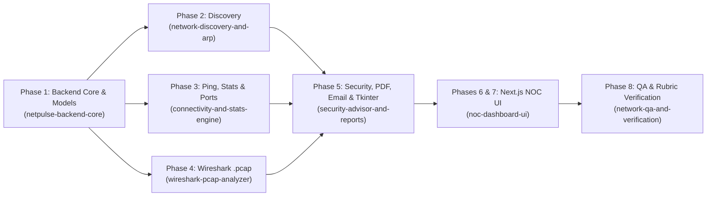

# 04 — Agentic Development Workflow & Custom Skills Guide

## 1. Philosophy: Skill-Driven Agentic Engineering

To build **NetPulse NOC** rapidly with zero regressions and strict adherence to the CCS 234 syllabus, this repository uses **Antigravity Workspace Skills** stored in `.agents/skills/`.

Each domain of the system has a dedicated `SKILL.md` runbook that instructs the AI agent (or subagents) on:
1. **Exact Python Networking / UI APIs to use** (and multi-scenario Windows/non-admin/offline fallbacks so raw sockets, Scapy, OUI lookup, and SMTP never crash in restricted environments).
2. **Canonical SQLModel, Pydantic, and TypeScript schemas** so Backend (`port 8000`), Frontend (`port 3000`), and the Native Tkinter Companion GUI (`backend/tkinter_gui.py`) match 100% on the first build.
3. **Self-Verification Commands** that the agent must run before marking any checklist item complete.

---

## 2. Installed Workspace Skills Roster (`.agents/skills/`)

| # | Skill Name | Path | Phase Covered | Core Responsibility |
| :- | :--- | :--- | :--- | :--- |
| **1** | `netpulse-backend-core` | [`.agents/skills/netpulse-backend-core/SKILL.md`](../.agents/skills/netpulse-backend-core/SKILL.md) | Phase 1 | FastAPI server setup, Hybrid SQLite WAL + Cloud PostgreSQL SQLModel ORM, unified `/ws/monitor` WebSocket hub, and Native Tkinter Companion GUI (`backend/tkinter_gui.py`) |
| **2** | `network-discovery-and-arp` | [`.agents/skills/network-discovery-and-arp/SKILL.md`](../.agents/skills/network-discovery-and-arp/SKILL.md) | Phase 2 | **Feature 1**: Smart NIC scorer (`psutil`), CIDR math & `/24` safety cap (`ipaddress`), Scapy ARP + ICMP + TCP probe + `arp -a` + Campus Simulation mode, offline OUI & Reverse DNS |
| **3** | `connectivity-and-stats-engine` | [`.agents/skills/connectivity-and-stats-engine/SKILL.md`](../.agents/skills/connectivity-and-stats-engine/SKILL.md) | Phase 3 | **Features 2 & 3 + Bonus**: 3-tier Ping engine (`icmplib` + OS Ping + `TCP-PING`), Min/Avg/Max RTT, Jitter, Packet Loss %, Async Socket Port Scanner + Banner Grabbing |
| **4** | `wireshark-pcap-analyzer` | [`.agents/skills/wireshark-pcap-analyzer/SKILL.md`](../.agents/skills/wireshark-pcap-analyzer/SKILL.md) | Phase 4 | **Topic 7 & Bonus**: Scapy packet sniffer + Active Socket Synthesizer fallback, BPF validation, OSI Layer 2–7 dissection, `.pcap` export/upload & Wireshark Desktop launcher |
| **5** | `security-advisor-and-reports` | [`.agents/skills/security-advisor-and-reports/SKILL.md`](../.agents/skills/security-advisor-and-reports/SKILL.md) | Phase 5 | **Features 4 & 5 + Bonus**: 4-category Security Recommendation rule engine, ReportLab PDF export, CSV/JSON export, SMTP Email alerts + Offline Outbox Preview |
| **6** | `noc-dashboard-ui` | [`.agents/skills/noc-dashboard-ui/SKILL.md`](../.agents/skills/noc-dashboard-ui/SKILL.md) | Phases 6 & 7 | Next.js 16 + `shadcn-admin` NOC Dark UI, Tremor/Recharts live telemetry charts, React Flow topology map, 3-pane packet UI, cross-page quick actions |
| **7** | `network-qa-and-verification` | [`.agents/skills/network-qa-and-verification/SKILL.md`](../.agents/skills/network-qa-and-verification/SKILL.md) | Phase 8 | Automated `pytest` verification, Tkinter self-test, Next.js build checks, `README.txt` packaging, and CCS 234 rubric audit |

---

## 3. Agentic Execution Pipeline & Orchestration Diagram

---

## 4. Agentic Skill Checklist & Invocation Prompts

Use the checklist below when executing the build with Antigravity:

- [ ] **Step 1 — Execute `netpulse-backend-core`**
  - *Prompt to Agent:* `"Activate skill netpulse-backend-core and complete Phase 1 of implementation-plan/03-STEP-BY-STEP-IMPLEMENTATION-CHECKLIST.md."`
- [ ] **Step 2 — Execute `network-discovery-and-arp` (Feature 1)**
  - *Prompt to Agent:* `"Activate skill network-discovery-and-arp and complete Phase 2 (Smart NIC scorer, CIDR calculator, offline OUI lookup, multi-tier ARP/ICMP/TCP/Simulation scanner, and discovery API router)."`
- [ ] **Step 3 — Execute `connectivity-and-stats-engine` (Features 2, 3 & Port Scanner Bonus)**
  - *Prompt to Agent:* `"Activate skill connectivity-and-stats-engine and complete Phase 3 (3-tier ICMP/OS/TCP ping engine, RTT/Jitter/Packet Loss statistics aggregator, async socket port scanner, and connectivity API router)."`
- [ ] **Step 4 — Execute `wireshark-pcap-analyzer` (Wireshark Integration)**
  - *Prompt to Agent:* `"Activate skill wireshark-pcap-analyzer and complete Phase 4 (Live Scapy packet capture + active socket synthesizer fallback, .pcap generator/uploader, OSI Layer 2-7 dissector, sample demo pcap, and packets API router)."`
- [ ] **Step 5 — Execute `security-advisor-and-reports` (Features 4, 5, PDF, Email & Tkinter Bonus)**
  - *Prompt to Agent:* `"Activate skill security-advisor-and-reports and complete Phase 5 (4-category security recommendations, ReportLab PDF diagnostic report generator, SMTP email notifier with local outbox, native Tkinter companion GUI, and routers)."`
- [ ] **Step 6 — Execute `noc-dashboard-ui` (Next.js Cyber-NOC Frontend)**
  - *Prompt to Agent:* `"Activate skill noc-dashboard-ui and complete Phases 6 and 7 (Cyber-NOC theme, shadcn-admin layout, WebSocket telemetry store, cross-page quick actions, and all 6 dashboard pages)."`
- [ ] **Step 7 — Execute `network-qa-and-verification` (Testing & Final Polish)**
  - *Prompt to Agent:* `"Activate skill network-qa-and-verification and complete Phase 8 (Run pytest suite, Tkinter self-test, Next.js build verification, and launcher script verification)."`
