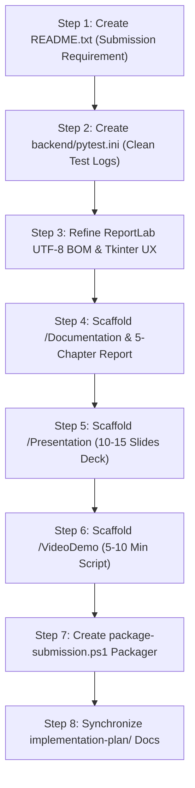

# 05 — CCS 234 Requirements Gap Analysis & Actionable Fix Checklist

> **Course:** CCS 234 — Communications and Networking (West Visayas State University — CICT)  
> **Evaluation Artifact:** Final Project / ALA for Finals Specification & Grading Rubric (6-Page Academic Specification)  
> **Project Codename:** `NetPulse NOC` (`sir-orly`)  
> **Status:** AUDITED — DO NOT RUN FIXES YET. Execute and verify one-by-one per this checklist.

---

## 📊 Executive Audit & Rubric Traceability Summary

A line-by-line comparison between the **CCS 234 6-Page Final Project Specification & Grading Rubric** and the current workspace (`sir-orly`) was conducted. 

### Grading Matrix Breakdown (100 Points Total)

| Rubric Criteria | Points | Current Technical Implementation State | Academic Deliverable State | Gap Level |
| :--- | :---: | :--- | :--- | :---: |
| **Functionality** | **30** | All 5 Core Features (Discovery, Ping, Stats, Reports, Security) fully functional in Python & Web UI | Functional in runtime | 🟢 Minimal (Minor UX polish) |
| **Technical Implementation** | **20** | Proper use of Python sockets, Scapy, ICMP, psutil, SQLModel, Wireshark .pcap | Highly compliant | 🟢 Zero Gaps |
| **User Interface and Design** | **10** | Dual GUI: Next.js 16 Web NOC + Native Python Tkinter Companion GUI | Dual-GUI exceeds requirements | 🟡 Theme consistency note |
| **Documentation** | **15** | Code is well-commented; architecture docs exist in `implementation-plan/` | **Missing `/Documentation` folder & 5-chapter report** | 🔴 **CRITICAL GAP** |
| **Testing and Evaluation** | **10** | Automated pytest suite + Tkinter `--self-test` + Next.js production build | Pytest deprecation warning | 🟡 Minor config fix |
| **Presentation & Demonstration** | **10** | Application is fully demonstrable live | **Missing `/Presentation` (10–15 slides) & `/VideoDemo` script** | 🔴 **CRITICAL GAP** |
| **Innovation & Creativity** | **5** | All 8 Bonus Features implemented (Tkinter, Charts, PDF, Email, Ports, Wireshark, WS, Cloud DB) | Full 8/8 bonus coverage | 🟢 Exceeds Rubric (5/5) |
| **Submission Penalty Guard** | — | `LASTNAME_FIRSTNAME_FINALPROJECT.zip` packaging & `README.txt` | **Missing `README.txt` & automated zip packager** | 🔴 **CRITICAL GAP** |

---

## 📑 Master Actionable Fix Checklist

Each item below represents a verified gap, missing component, or inconsistency. They are numbered sequentially so they can be executed and verified **one-by-one**.

---

### Phase 1: Critical Submission Deliverables & Packaging (Rubric Penalty Protection)

- [ ] **1.1 Create Plaintext `README.txt` at Project Root & Submission Bundle**
  - **Rubric / Requirement Traceability:** PDF Page 2, Page 4, and Page 6 mandate `README.txt` inside `LASTNAME_FIRSTNAME_FINALPROJECT.zip`. The PDF explicitly warns: *"Failure to submit any required component will result in deductions according to the grading rubric."*
  - **Current Project Status:** Only `README.md` exists. There is no `README.txt`.
  - **Inconsistency / Gap:** Plaintext format required by automated university submission crawlers and grading scripts.
  - **Actionable Fix / Execution Guide:**
    1. Create `README.txt` in project root using standard ASCII/UTF-8 formatting.
    2. Include:
       - Student Name, Course (CCS 234), Section, Academic Year (2026), Project Title.
       - System Overview & Architecture Summary.
       - System Requirements (Python 3.11+, Node.js 18+, Npcap optional).
       - Step-by-Step Installation & Setup Commands (`python -m venv backend\.venv`, `pip install -r backend\requirements.txt`, `npm install`).
       - Step-by-Step Running Instructions (`.\start-netpulse.ps1`, `.\start-netpulse.ps1 -IncludeTkinter`, or manual start).
       - Direct mapping of the 5 Core Features and 8 Bonus Features to files and UI routes.
       - Default URLs (`http://localhost:3000` Web NOC, `http://localhost:8000/docs` FastAPI Swagger, `backend/tkinter_gui.py`).
  - **Verification:** Run `Test-Path "README.txt"` in PowerShell; inspect contents for readable plaintext formatting.

---

- [ ] **1.2 Create `/Documentation` Deliverable Folder & 5-Chapter Technical Report Artifacts**
  - **Rubric / Requirement Traceability:** PDF Page 1, Page 2, and Page 3 (15 Points Documentation Rubric). Length: **8 to 12 pages**.
  - **Mandated Structure:**
    - Chapter 1: Introduction (Background, Problem Statement, Objectives)
    - Chapter 2: System Design (Network Architecture, Flowchart, Use Case Diagram)
    - Chapter 3: Implementation (Tools Used, Source Code Description)
    - Chapter 4: Results and Testing (Screenshots, Performance Evaluation)
    - Chapter 5: Conclusions and Recommendations
    - References
  - **Formatting Attributes (Strict PDF Page 1 Section 7):**
    - Font: **Times New Roman, 12 points**
    - Alignment: **Full justified**
    - Allowed styles: **Only bold, italic & underline**
    - Spacing: **Double-spaced**
    - Submission note: Excluded from zip file, to be submitted online via Microsoft Teams.
  - **Current Project Status:** `/Documentation` folder does not exist. `implementation-plan/README.md` line 6 incorrectly assumed documentation was excluded from the project.
  - **Actionable Fix / Execution Guide:**
    1. Create directory `Documentation/`.
    2. Generate `Documentation/CCS234_Final_Technical_Report.md` and a formatted Word document (`.docx`) adhering strictly to Times New Roman 12pt, double spaced, full justified.
    3. Include complete technical text for all 5 chapters, Mermaid architecture diagrams, use case descriptions, test logs, and IEEE citations.
    4. Provide an automated python script `Documentation/generate_report_docx.py` using `python-docx` to compile the report with the exact university margins, font sizes, and justification.
  - **Verification:** Verify `Documentation/` contains the 8–12 page report with all 5 chapters and proper styling.

---

- [ ] **1.3 Create `/Presentation` Deliverable Folder & 10–15 Slides Deck Outline**
  - **Rubric / Requirement Traceability:** PDF Page 1, Page 2, Page 4 (10 Points Presentation and Demonstration).
  - **Mandated Outline (10 to 15 slides):**
    1. Title Slide
    2. Project Overview
    3. Problem Statement
    4. Objectives
    5. Methodology
    6. System Architecture
    7. Program Features (Core 1–5 + Bonus Features)
    8. Live Demonstration Guide
    9. Test Results & QoS Performance Evaluation
    10. Conclusion & Recommendations
  - **Current Project Status:** `/Presentation` folder does not exist.
  - **Actionable Fix / Execution Guide:**
    1. Create directory `Presentation/`.
    2. Create `Presentation/SLIDES_OUTLINE.md` detailing slide-by-slide speaker notes, bullet points, and visual asset suggestions.
    3. Create a Python script `Presentation/generate_slides.py` using `python-pptx` to generate the official styled `.pptx` presentation deck (`Presentation/NetPulse_NOC_Presentation.pptx`).
  - **Verification:** Verify `Presentation/` contains both the Markdown slide outline and the 10–15 slide `.pptx` file.

---

- [ ] **1.4 Create `/VideoDemo` Deliverable Folder & 5–10 Minute Video Recording Script**
  - **Rubric / Requirement Traceability:** PDF Page 1, Page 2, Page 4 (Demonstration Video: 5–10 minutes, formal attire).
  - **Mandated Video Agenda:**
    1. Application Start-up (Launcher, backend terminal, Web NOC, Tkinter companion)
    2. Program Features (Discovery, Ping, Stats, Port Scan, Wireshark Dissector, Security Rules)
    3. Testing Results (QoS latency, packet loss, pytest execution, self-test)
    4. Final Output (PDF report download, CSV export, email outbox review)
  - **Current Project Status:** `/VideoDemo` folder does not exist.
  - **Actionable Fix / Execution Guide:**
    1. Create directory `VideoDemo/`.
    2. Create `VideoDemo/RECORDING_SCRIPT_AND_STORYBOARD.md` with second-by-second timing, what to click on screen, talking points for formal defense, and camera attire reminders.
    3. Create `VideoDemo/README.txt` with instructions for placing the final `.mp4` recording prior to submission.
  - **Verification:** Check `VideoDemo/` directory and ensure script covers all 4 required sections within the 5–10 minute timeframe.

---

- [ ] **1.5 Create Automated Zip Packaging Script (`package-submission.ps1`)**
  - **Rubric / Requirement Traceability:** PDF Page 2 & Page 6: Folder naming format `LASTNAME_FIRSTNAME_FINALPROJECT.zip`.
  - **Mandated Zip Hierarchy:**
    ```
    LASTNAME_FIRSTNAME_FINALPROJECT.zip
    ├── SourceCode/
    │   ├── backend/
    │   ├── src/
    │   ├── public/
    │   ├── package.json
    │   ├── tsconfig.json
    │   ├── start-netpulse.ps1
    │   └── README.md
    ├── Presentation/
    │   └── NetPulse_NOC_Presentation.pptx
    ├── VideoDemo/
    │   └── NetPulse_Demo_Video.mp4 (or link/script)
    └── README.txt
    ```
    *(Note: PDF specifies `/Documentation` is excluded from zip and submitted online via Teams).*
  - **Current Project Status:** No packaging script exists. Manual compression risks including giant `.venv` (hundreds of MBs), `.next` build artifacts, `node_modules`, or SQLite WAL lock files.
  - **Actionable Fix / Execution Guide:**
    1. Create `package-submission.ps1` in project root.
    2. Script prompts for or accepts `-LastName` and `-FirstName`.
    3. Excludes `node_modules/`, `backend/.venv/`, `.next/`, `*.db-shm`, `*.db-wal`, `__pycache__/`, `.pytest_cache/`.
    4. Structures clean `/SourceCode`, `/Presentation`, `/VideoDemo`, and `README.txt`.
    5. Validates that all required files exist before zipping, then creates `LASTNAME_FIRSTNAME_FINALPROJECT.zip`.
  - **Verification:** Run `.\package-submission.ps1 -LastName "DELACRUZ" -FirstName "JUAN" -DryRun` and verify file manifest.

---

### Phase 2: Testing & Backend Configuration Fixes

- [ ] **2.1 Configure Pytest Asyncio Default Loop Scope to Eliminate Deprecation Warnings**
  - **Rubric / Requirement Traceability:** Testing and Evaluation (10 Points Rubric). Clean, warning-free automated test runs.
  - **Current Project Status:** Running `pytest` outputs:
    `PytestDeprecationWarning: The configuration option "asyncio_default_fixture_loop_scope" is unset.`
  - **Inconsistency / Gap:** Missing pytest configuration file specifying the asyncio fixture loop scope.
  - **Actionable Fix / Execution Guide:**
    1. Create `backend/pytest.ini` with:
       ```ini
       [pytest]
       asyncio_default_fixture_loop_scope = function
       testpaths = tests
       python_files = test_*.py
       ```
    2. Verify tests run without the deprecation notice.
  - **Verification:** Run `backend\.venv\Scripts\pytest backend\tests\test_interface_detector.py` and confirm warning is gone.

---

- [ ] **2.2 Ensure ReportLab CSV Export Generates UTF-8 BOM for Microsoft Excel on Windows**
  - **Rubric / Requirement Traceability:** Feature 4: Network Report Generator (30 Points Functionality).
  - **Current Project Status:** In `backend/app/services/report_generator.py`, `export_report_csv()` writes UTF-8 plain text without BOM (`\ufeff`).
  - **Inconsistency / Gap:** On Windows systems in the Philippines (standard WVSU CICT environment), double-clicking a CSV file opens Microsoft Excel with default ANSI/Windows-1252 codepage unless a UTF-8 Byte Order Mark (BOM) is present, potentially causing misaligned column headers or character encoding artifacts.
  - **Actionable Fix / Execution Guide:**
    1. In `backend/app/services/report_generator.py`, ensure the CSV string output starts with `\ufeff`.
    2. In `backend/app/routers/reports.py`, ensure the `Response(content=..., media_type="text/csv; charset=utf-8")` header specifies UTF-8.
  - **Verification:** Open generated CSV in Excel and check that headers format into distinct columns without garbled symbols.

---

- [ ] **2.3 Expand Port Scanner (`PORT_CATALOG`) with Additional Database & Infrastructure Ports**
  - **Rubric / Requirement Traceability:** Bonus Feature 5: Port Scanner (5 Points Innovation Rubric) & Feature 5: Security Recommendations (Firewall category).
  - **Current Project Status:** `PORT_CATALOG` in `backend/app/services/port_scanner.py` defines 25 standard ports. Uncatalogued ports fallback to generic LOW risk.
  - **Inconsistency / Gap:** Common enterprise/lab ports such as `5432` (PostgreSQL), `27017` (MongoDB), `9200` (Elasticsearch), `161` (SNMP UDP), and `8081/8888` (Alternative HTTP admin) should be explicitly cataloged with their exact OSI Layer and Risk Level so scans provide maximum diagnostic depth.
  - **Actionable Fix / Execution Guide:**
    1. In `backend/app/services/port_scanner.py`, update `PORT_CATALOG` with entries for `161/SNMP`, `8081/HTTP-Alt`, `9000/Admin`, `9200/Elasticsearch`, `27017/MongoDB`.
    2. In heuristic fallback for unknown ports, categorize ports with banners containing "HTTP", "Server", "Admin", or "API" as `MEDIUM` rather than `LOW`.
  - **Verification:** Run `backend\.venv\Scripts\pytest backend\tests\test_port_scanner.py`.

---

- [ ] **2.4 Enhance Tkinter Companion GUI Security Evaluation Feedback & Status Notifications**
  - **Rubric / Requirement Traceability:** Bonus Feature 1: GUI using Tkinter (5 Points Innovation Rubric).
  - **Current Project Status:** In `backend/tkinter_gui.py`, clicking "🛡️ Evaluate Security Rules" calls `_refresh_tables()`, but does not provide visual confirmation or summary dialog indicating how many rules triggered and the resulting security score.
  - **Inconsistency / Gap:** User lacks immediate feedback that an active evaluation occurred.
  - **Actionable Fix / Execution Guide:**
    1. In `backend/tkinter_gui.py`, update `_run_security_eval()` to compute security rules, update a status banner:
       `"Security Posture Evaluated: Score XX/100 (Grade X) | N Recommendations Generated"`,
       and display an informational status toast or message box.
  - **Verification:** Run `python backend/tkinter_gui.py`, click "Evaluate Security Rules", and verify the status message updates with score and alert count.

---

### Phase 3: UI, Theme Consistency & Cross-Navigation Polish

- [ ] **3.1 Harmonize Theme Architecture Documentation (`02-UI-THEME-AND-TEMPLATE-GUIDE.md`)**
  - **Rubric / Requirement Traceability:** User Interface and Design (10 Points Rubric).
  - **Current Project Status:** `02-UI-THEME-AND-TEMPLATE-GUIDE.md` describes an all-dark Cyber-NOC Obsidian palette (`#090D16`). The native Tkinter GUI (`backend/tkinter_gui.py`) and embedded terminal widgets follow this dark palette. However, the Next.js Web NOC (`src/app/`) implements a high-legibility enterprise NOC style (`#F3F6FB` background, crisp white KPI cards, dark telemetry charts, and high-contrast monospace tables).
  - **Inconsistency / Gap:** The documentation guide should explicitly articulate the **Dual-Surface Theme Architecture**:
    - *Surface A (Desktop Tkinter):* Classic Cyber-Dark Console (`#090D16` / Consolas).
    - *Surface B (Web NOC):* Enterprise Operations Center Light Canvas (`#F3F6FB`) with dark telemetry chart embeddings and dark terminal stream consoles.
  - **Actionable Fix / Execution Guide:**
    1. Update `implementation-plan/02-UI-THEME-AND-TEMPLATE-GUIDE.md` to document the dual-surface design philosophy, ensuring grading instructors understand the deliberate contrast between the native desktop console and the web dashboard.
  - **Verification:** Inspect `implementation-plan/02-UI-THEME-AND-TEMPLATE-GUIDE.md` for dual-surface documentation.

---

- [ ] **3.2 Verify Seamless Cross-Page Deep Linking (`?target=IP`) across All 6 Web Pages**
  - **Rubric / Requirement Traceability:** User Interface and Design (10 Points Rubric) & Usability.
  - **Current Project Status:** Discovered devices in Overview (`/`) and Discovery (`/discovery`) have 1-click action buttons (`Ping Host`, `Scan Ports`) that navigate to `/connectivity?target=IP&tab=ping` or `/connectivity?target=IP&tab=ports`.
  - **Actionable Fix / Execution Guide:**
    1. Confirm that when a user clicks "Ping" on a discovered device, `/connectivity` immediately selects the host and automatically populates the Ping Target input.
    2. Confirm that when a user clicks "Scan Ports", `/connectivity` switches to the "Port Scanner" tab with the target prefilled.
    3. Ensure breadcrumbs and back-navigation buttons allow returning to the device table seamlessly.
  - **Verification:** Run `npm run build` to confirm no Next.js Suspense boundary errors occur with `useSearchParams`.

---

### Phase 4: Implementation Plan Synchronizations

- [ ] **4.1 Update `implementation-plan/README.md` to Include Documentation & Defense Deliverables**
  - **Rubric / Requirement Traceability:** Project Integrity & Implementation Completeness.
  - **Current Project Status:** Line 6 of `implementation-plan/README.md` previously noted: *(Presentation, Documentation, and Video excluded per instructions)*.
  - **Inconsistency / Gap:** Since the grading rubric allocates 25 points to Documentation and Presentation, the master implementation plan must formally include these phases.
  - **Actionable Fix / Execution Guide:**
    1. Update `implementation-plan/README.md` Section 2 (Rubric Traceability Matrix) to incorporate Documentation (15 pts) and Presentation/Demo (10 pts).
    2. Add references to `05-REQUIREMENTS-GAP-ANALYSIS-AND-FIX-CHECKLIST.md`.
  - **Verification:** Review `implementation-plan/README.md` for complete 100/100 point rubric alignment.

---

- [ ] **4.2 Append Submission Phases to `implementation-plan/03-STEP-BY-STEP-IMPLEMENTATION-CHECKLIST.md`**
  - **Rubric / Requirement Traceability:** Complete roadmap tracking.
  - **Current Project Status:** `03-STEP-BY-STEP-IMPLEMENTATION-CHECKLIST.md` currently ends at Phase 8 (Quality Assurance & Rubric Verification).
  - **Actionable Fix / Execution Guide:**
    1. Append Phase 9: Academic Technical Report (`/Documentation`), Phase 10: Defense Slides (`/Presentation`), Phase 11: Video Demo Scripting (`/VideoDemo`), and Phase 12: Final Zip Delivery (`LASTNAME_FIRSTNAME_FINALPROJECT.zip`).
  - **Verification:** Check `03-STEP-BY-STEP-IMPLEMENTATION-CHECKLIST.md` line count and verify all 12 phases are represented.

---

## 🚀 Recommended Fix Execution Order

When you are ready to apply these fixes, proceed in the following order:



> **Reminder:** None of the above fixes have been applied yet, in accordance with your instruction (*"dont run it yet, but list it one by one wherein i could run and perform fix one-by-one per checklist"*). All items above are ready to be executed on your command.
