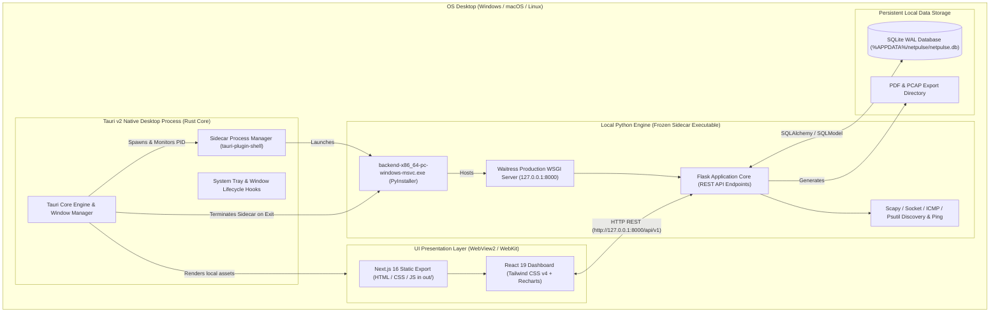

# NetPulse NOC: Desktop Bundle Implementation Plan
## Tauri v2 + Next.js 16 + Flask + SQLite

> **Target Platform:** Desktop (Windows 10/11 x64, macOS, Linux)  
> **Architecture:** Tauri v2 Native Host + Next.js 16 Static Export (WebView2) + PyInstaller-Frozen Flask WSGI Sidecar + Local SQLite WAL  
> **Target Output:** Single-click Standalone Installer (`.msi` / `.exe` setup via NSIS) with zero external Python or Node.js runtime requirements.

---

## 1. System Architecture Overview

The desktop distribution bundles the entire NetPulse SOC/NOC platform into a high-performance, secure, standalone desktop application.



### Key Architectural Decisions:
1. **Zero External Runtime Requirement:** Users do not need Python, Node.js, Git, or compilers installed. Everything is bundled into the native installer.
2. **Next.js Static Export (`output: "export"`):** Compiles all React pages (`/`, `/discovery`, `/connectivity`, `/packets`, `/reports`, `/security`) into pure static HTML, CSS, and client-side JavaScript in the `out/` folder, loaded instantly by Tauri's native WebView2 engine with no Node server overhead.
3. **Flask as Frozen Sidecar (`Waitress` WSGI):** The Python backend is compiled via PyInstaller into a standalone executable (`backend-x86_64-pc-windows-msvc.exe`) placed in `src-tauri/bin/`. Tauri automatically spawns this executable on application launch and terminates it on exit.
4. **Isolated SQLite in User AppData:** The database is stored in `%APPDATA%\netpulse\netpulse.db` (Windows) or `~/.local/share/netpulse/` (Linux), ensuring the application can write database updates without requiring administrative permissions in `C:\Program Files\`.

---

## 2. Prerequisites & Build Toolchain

Ensure the following tools are installed on the development/build machine:

| Tool | Version Requirement | Purpose |
| :--- | :--- | :--- |
| **Rust & Cargo** | 1.77.0+ (stable-x86_64-pc-windows-msvc) | Compiles the Tauri v2 desktop shell |
| **Node.js** | 20.x or 22.x LTS | Builds the Next.js 16 frontend |
| **Python** | 3.11.x or 3.12.x (64-bit) | Executes and bundles the backend |
| **PyInstaller** | 6.5.0+ | Freezes Python, Flask, Scapy, and dependencies into a sidecar executable |
| **Microsoft C++ Build Tools** | VS 2022 (v143) | Required by Cargo and PyInstaller C-extensions |
| **Wireshark / Npcap** | Optional for dev | Required only for raw promiscuous packet capture |

---

## 3. Directory Layout with Tauri v2

```
sir-orly/
├── src/                          # Next.js 16 Frontend App Router & Components
├── public/                       # Static public assets
├── out/                          # Generated static export directory (Tauri frontendDist)
├── backend/                      # Python Backend
│   ├── app/                      # Shared business logic, models, and services
│   ├── flask_main.py             # Dedicated Flask WSGI application entrypoint
│   ├── build_sidecar.py          # PyInstaller automation script
│   └── requirements.txt          # Backend dependencies
├── src-tauri/                    # Tauri v2 Desktop Project
│   ├── bin/                      # PyInstaller compiled sidecars
│   │   └── backend-x86_64-pc-windows-msvc.exe
│   ├── capabilities/             # Tauri v2 Security Capabilities
│   │   └── default.json
│   ├── icons/                    # App icons (.ico, .png)
│   ├── src/
│   │   └── main.rs               # Rust application entrypoint & sidecar supervisor
│   ├── Cargo.toml                # Rust dependencies (tauri v2, tauri-plugin-shell)
│   └── tauri.conf.json           # Tauri v2 configuration
├── package.json
└── next.config.ts
```

---

## 4. Phase-by-Phase Implementation Steps

### Phase 1: Configure Next.js 16 for Static Export (`output: "export"`)

Tauri serves local web assets from disk. Next.js 16 must be configured to generate a static output bundle.

1. **Update `next.config.ts`**:
   ```typescript
   import type { NextConfig } from "next";

   const nextConfig: NextConfig = {
     output: "export",
     distDir: "out",
     images: {
       unoptimized: true, // Native WebView does not run Next.js image optimization server
     },
     trailingSlash: true, // Guarantees proper routing for static HTML files
   };

   export default nextConfig;
   ```

2. **Configure API Base URL in `src/lib/api.ts`**:
   Ensure the frontend dynamically targets the local Flask sidecar on `127.0.0.1:8000`:
   ```typescript
   export const API_BASE_URL =
     process.env.NEXT_PUBLIC_API_BASE_URL || "http://127.0.0.1:8000/api/v1";
   ```

3. **Verify Build**:
   ```powershell
   npm run build
   ```
   *Verification:* Ensure the `out/` directory is created and contains `index.html`, `connectivity/index.html`, `discovery/index.html`, `packets/index.html`, `reports/index.html`, and `security/index.html`.

---

### Phase 2: Create the Flask WSGI Application & SQLite Storage

Create `backend/flask_main.py` to provide a robust Flask WSGI server wrapping the existing NetPulse services, backed by Waitress for multi-threaded Windows execution.

```python
"""Flask WSGI Server for NetPulse Desktop (Tauri Sidecar)."""
import os
import sys
import logging
from pathlib import Path
from flask import Flask, jsonify, request, send_file
from flask_cors import CORS
from waitress import serve

# Configure logging
logging.basicConfig(level=logging.INFO, format="%(asctime)s [%(levelname)s] %(message)s")
logger = logging.getLogger("netpulse_flask")

# Resolve AppData storage path for persistent SQLite
def get_storage_dir() -> Path:
    if sys.platform == "win32":
        base = Path(os.environ.get("APPDATA", Path.home()))
    elif sys.platform == "darwin":
        base = Path.home() / "Library" / "Application Support"
    else:
        base = Path.home() / ".local" / "share"
    
    app_dir = base / "NetPulse"
    app_dir.mkdir(parents=True, exist_ok=True)
    return app_dir

STORAGE_DIR = get_storage_dir()
DB_PATH = STORAGE_DIR / "netpulse.db"
os.environ["DATABASE_URL"] = f"sqlite:///{DB_PATH}"

# Import database & services from core backend
from app.database import init_db, get_session
from app.services.interface_detector import get_network_interfaces
from app.services.network_scanner import network_scanner
from app.services.ping_engine import ping_engine
from app.services.port_scanner import port_scanner
from app.services.packet_sniffer import packet_sniffer
from app.services.security_advisor import security_advisor
from app.services.report_generator import report_generator

# Initialize Flask app
app = Flask(__name__)
CORS(app, resources={r"/api/*": {"origins": "*"}})

# Initialize SQLite tables on startup
init_db()

@app.route("/api/v1/health", methods=["GET"])
def health():
    nic_info = get_network_interfaces()
    return jsonify({
        "status": "healthy",
        "service": "NetPulse Desktop Core",
        "version": "1.0.0",
        "database": {"mode": "SQLITE_LOCAL", "path": str(DB_PATH)},
        "active_interface": nic_info.get("active_interface"),
        "network_status": {
            "internet_reachable": nic_info.get("internet_reachable", False),
            "hostname": nic_info.get("hostname", "localhost"),
        }
    })

@app.route("/api/v1/discovery/interfaces", methods=["GET"])
def get_interfaces():
    return jsonify(get_network_interfaces())

@app.route("/api/v1/discovery/scan", methods=["POST"])
def scan_network():
    data = request.get_json() or {}
    cidr = data.get("subnet_cidr")
    devices = network_scanner.scan_subnet(cidr)
    return jsonify({"discovered_devices": devices, "count": len(devices)})

@app.route("/api/v1/connectivity/ping", methods=["POST"])
def ping_host():
    data = request.get_json() or {}
    target = data.get("target_ip", "127.0.0.1")
    count = int(data.get("count", 4))
    res = ping_engine.ping(target, count=count)
    return jsonify(res)

@app.route("/api/v1/connectivity/port-scan", methods=["POST"])
def scan_ports():
    data = request.get_json() or {}
    ip = data.get("target_ip", "127.0.0.1")
    ports = data.get("ports", [21, 22, 80, 443, 8080])
    res = port_scanner.scan_host(ip, ports)
    return jsonify(res)

@app.route("/api/v1/security/recommendations", methods=["GET"])
def get_security_recommendations():
    recs = security_advisor.evaluate_security()
    return jsonify(recs)

@app.route("/api/v1/reports/generate", methods=["POST"])
def generate_report():
    data = request.get_json() or {}
    fmt = data.get("format", "PDF").upper()
    file_path = report_generator.create_report(file_format=fmt)
    return send_file(file_path, as_attachment=True)

@app.route("/api/v1/system/shutdown", methods=["POST"])
def shutdown():
    """Endpoint for graceful sidecar termination from Tauri."""
    logger.info("Shutdown request received from Tauri host.")
    sys.exit(0)

def main():
    port = int(os.environ.get("NETPULSE_PORT", 8000))
    logger.info(f"Starting NetPulse Flask sidecar on 127.0.0.1:{port} (Waitress WSGI)...")
    serve(app, host="127.0.0.1", port=port, threads=6)

if __name__ == "__main__":
    main()
```

---

### Phase 3: Freeze Flask into a Tauri Sidecar via PyInstaller

Tauri requires sidecars to follow target-triple naming conventions:
- Windows x64: `backend-x86_64-pc-windows-msvc.exe`
- Linux x64: `backend-x86_64-unknown-linux-gnu`
- macOS Apple Silicon: `backend-aarch64-apple-darwin`

1. **Install Build Requirements**:
   ```powershell
   pip install pyinstaller waitress flask flask-cors
   ```

2. **Create PyInstaller Build Script (`backend/build_sidecar.py`)**:
   ```python
   import subprocess
   import sys
   import shutil
   from pathlib import Path

   def build():
       backend_dir = Path(__file__).resolve().parent
       root_dir = backend_dir.parent
       bin_dir = root_dir / "src-tauri" / "bin"
       bin_dir.mkdir(parents=True, exist_ok=True)

       # Target triple for Windows
       target_name = "backend-x86_64-pc-windows-msvc.exe"
       output_path = bin_dir / target_name

       print(f"[*] Building frozen sidecar executable for Tauri: {target_name}")

       cmd = [
           sys.executable, "-m", "PyInstaller",
           "--noconfirm",
           "--onefile",
           "--name", "backend",
           "--distpath", str(bin_dir),
           "--workpath", str(backend_dir / "build"),
           "--specpath", str(backend_dir),
           "--collect-all", "scapy",
           "--collect-all", "reportlab",
           "--collect-all", "sqlmodel",
           "--hidden-import", "waitress",
           "--hidden-import", "sqlite3",
           str(backend_dir / "flask_main.py")
       ]
       subprocess.check_call(cmd)

       # Rename output to match Tauri target triple
       dist_exe = bin_dir / "backend.exe"
       if dist_exe.exists():
           if output_path.exists():
               output_path.unlink()
           dist_exe.rename(output_path)
           print(f"[+] Successfully compiled sidecar: {output_path}")

   if __name__ == "__main__":
       build()
   ```

3. **Run Sidecar Build**:
   ```powershell
   python backend/build_sidecar.py
   ```

---

### Phase 4: Configure Tauri v2 Desktop Project

1. **Initialize Tauri in Workspace**:
   ```powershell
   npm install --save-dev @tauri-apps/cli@^2.0.0
   npx tauri init
   ```
   *Prompts:*
   - App Name: `NetPulse`
   - Window Title: `NetPulse SOC/NOC - Network Diagnostic System`
   - Web assets path: `../out`
   - Dev server URL: `http://localhost:3000`

2. **Add Tauri Shell Plugin for Sidecar Management**:
   ```powershell
   npm install @tauri-apps/plugin-shell@^2.0.0
   npm install @tauri-apps/plugin-process@^2.0.0
   ```

3. **Configure `src-tauri/Cargo.toml`**:
   ```toml
   [package]
   name = "netpulse-desktop"
   version = "1.0.0"
   description = "NetPulse SOC/NOC Desktop Monitor"
   edition = "2021"

   [dependencies]
   tauri = { version = "2.0.0", features = [] }
   tauri-plugin-shell = "2.0.0"
   tauri-plugin-process = "2.0.0"
   serde = { version = "1.0", features = ["derive"] }
   serde_json = "1.0"
   reqwest = { version = "0.12", features = ["blocking", "json"] }
   ```

4. **Configure `src-tauri/tauri.conf.json`**:
   ```json
   {
     "$schema": "https://schema.tauri.app/config/2",
     "productName": "NetPulse",
     "version": "1.0.0",
     "identifier": "com.netpulse.noc",
     "build": {
       "beforeDevCommand": "npm run dev",
       "devUrl": "http://localhost:3000",
       "beforeBuildCommand": "npm run build",
       "frontendDist": "../out"
     },
     "app": {
       "windows": [
         {
           "title": "NetPulse SOC/NOC - Cyber-Physical Control Center",
           "width": 1440,
           "height": 900,
           "minWidth": 1024,
           "minHeight": 700,
           "resizable": true,
           "fullscreen": false
         }
       ],
       "security": {
         "csp": null
       }
     },
     "bundle": {
       "active": true,
       "targets": ["msi", "nsis"],
       "icon": [
         "icons/32x32.png",
         "icons/128x128.png",
         "icons/icon.ico"
       ],
       "externalBin": [
         "bin/backend"
       ]
     }
   }
   ```

5. **Grant Sidecar Permissions in `src-tauri/capabilities/default.json`**:
   ```json
   {
     "$schema": "../gen/schemas/desktop-schema.json",
     "identifier": "default",
     "description": "Default capability for the application window",
     "windows": ["main"],
     "permissions": [
       "core:default",
       "shell:allow-execute",
       {
         "identifier": "shell:allow-spawn",
         "allow": [
           {
             "name": "bin/backend",
             "sidecar": true
           }
         ]
       }
     ]
   }
   ```

---

### Phase 5: Implement Rust Sidecar Lifecycle Supervisor

In `src-tauri/src/main.rs`, spawn the Python Flask sidecar on startup, poll its health check endpoint until ready, and terminate it cleanly when the window is closed.

```rust
// Prevents additional console window on Windows in release
#![cfg_attr(not(debug_assertions), windows_subsystem = "windows")]

use std::time::Duration;
use std::thread;
use tauri::{AppHandle, Manager, RunEvent};
use tauri_plugin_shell::ShellExt;

fn wait_for_backend_health() {
    let client = reqwest::blocking::Client::builder()
        .timeout(Duration::from_millis(500))
        .build()
        .unwrap();

    let health_url = "http://127.0.0.1:8000/api/v1/health";
    for _ in 0..30 {
        if let Ok(resp) = client.get(health_url).send() {
            if resp.status().is_success() {
                println!("[+] Python Flask sidecar is healthy and accepting traffic!");
                return;
            }
        }
        thread::sleep(Duration::from_millis(200));
    }
    eprintln!("[!] Warning: Python Flask sidecar health check timed out.");
}

fn main() {
    tauri::Builder::default()
        .plugin(tauri_plugin_shell::init())
        .plugin(tauri_plugin_process::init())
        .setup(|app| {
            let handle = app.handle().clone();
            
            // Spawn the frozen Flask sidecar binary
            let sidecar_command = handle.shell().sidecar("backend").expect("Failed to locate backend sidecar binary");
            let (_rx, child) = sidecar_command.spawn().expect("Failed to spawn backend sidecar process");
            
            println!("[+] Launched backend sidecar with PID: {}", child.pid());

            // Poll health endpoint in background thread
            thread::spawn(move || {
                wait_for_backend_health();
            });

            Ok(())
        })
        .build(tauri::generate_context!())
        .expect("Error while running Tauri application")
        .run(|_app_handle, event| {
            if let RunEvent::ExitRequested { .. } = event {
                // Graceful sidecar termination
                let client = reqwest::blocking::Client::new();
                let _ = client.post("http://127.0.0.1:8000/api/v1/system/shutdown")
                    .timeout(Duration::from_millis(500))
                    .send();
            }
        });
}
```

---

## 5. Build & Packaging Pipeline

To produce the final production installer:

```powershell
# Step 1: Export Next.js 16 Static Frontend
npm run build

# Step 2: Compile Flask Sidecar with PyInstaller
python backend/build_sidecar.py

# Step 3: Compile Tauri Desktop Binary & Generate Installer
npx tauri build
```

### Output Artifacts:
The compiled release installer will be generated in:
- `src-tauri/target/release/bundle/nsis/NetPulse_1.0.0_x64-setup.exe` (Single-file Windows Installer)
- `src-tauri/target/release/bundle/msi/NetPulse_1.0.0_x64_en-US.msi` (Enterprise MSI Installer)

---

## 6. Desktop Edge-Case Resilience & Verification Checklist

- [ ] **Zero Admin Requirement:** App installs and runs under standard non-admin Windows user accounts; SQLite writes to `%APPDATA%\NetPulse\netpulse.db`.
- [ ] **No Zombie Sidecars:** Closing the Tauri desktop window immediately triggers sidecar cleanup via Tauri's `ExitRequested` hook and Flask's `/shutdown` endpoint.
- [ ] **Port Conflict Handling:** If port `8000` is occupied, allow passing a dynamic port via environment variable `NETPULSE_PORT` from Rust to Flask.
- [ ] **Offline LAN Operation:** All UI icons, fonts, and scripts are self-contained in Next.js `out/` with zero CDN references.
- [ ] **Windows Defender SmartScreen:** In production, sign the resulting `.exe` and `.msi` using a standard code signing certificate or Microsoft Trusted Signing.
