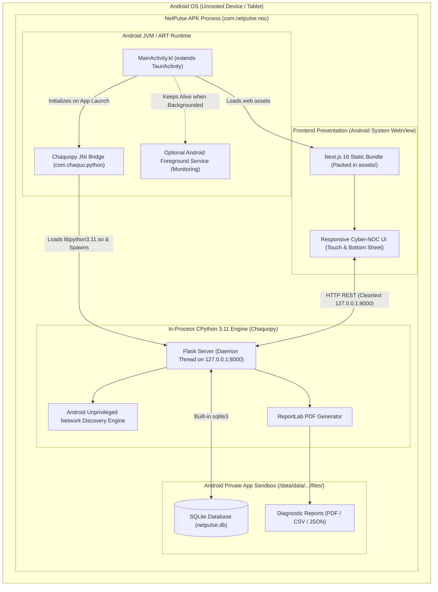

# NetPulse NOC: Mobile APK Implementation Plan
## Tauri 2 + Next.js 16 + Embedded Python via Chaquopy + SQLite

> **Target Platform:** Mobile (Android 8.0+ / API 26–35, ARM64-v8a & x86_64)  
> **Architecture:** Tauri 2 Android Shell + Next.js 16 Static Export (Android WebView) + Chaquopy In-Process Embedded Python Runtime + Flask API + Private App Sandbox SQLite  
> **Target Output:** Standalone Signed Android Package (`.apk`) / Android App Bundle (`.aab`) with zero external runtime or rooting required.

---

## 1. System Architecture Overview

Running a full-featured network diagnostic, traffic analysis, and SOC dashboard on Android poses unique challenges:
1. Android security policies forbid executing unauthorized binary sidecars from arbitrary directories.
2. Non-root apps cannot open raw sockets (`SOCK_RAW`) for Scapy promiscuous capture or Layer 2 ARP broadcast.
3. Android 9+ (API 28+) strictly blocks cleartext HTTP (`http://127.0.0.1:8000`) unless explicitly permitted.

This architecture leverages **Chaquopy** to embed a real CPython 3.11 runtime directly inside the Android JVM process via the Java Native Interface (JNI). The Flask REST API runs on an in-memory background daemon thread, allowing the Next.js static WebView to communicate over `127.0.0.1` identically to desktop.



---

## 2. Prerequisites & Build Toolchain

Ensure the following tools are installed on your development workstation:

| Tool | Version Requirement | Purpose |
| :--- | :--- | :--- |
| **Java Development Kit (JDK)** | OpenJDK 17 or 21 (LTS) | Compiles Android Gradle projects |
| **Android SDK & Build-Tools** | API 34 or 35 (Build tools 34.0.0+) | Android compilation framework |
| **Android NDK** | 25.x or 26.x | Native compilation of Python shared libraries |
| **Rust & Cargo** | 1.77.0+ with `aarch64-linux-android` target | Tauri 2 native mobile core |
| **Tauri CLI v2** | `^2.0.0` (`@tauri-apps/cli`) | Manages mobile initialization and packaging |
| **Chaquopy Gradle Plugin** | `15.0.1` | Embeds Python runtime and resolves pip packages |
| **Node.js** | 20.x or 22.x LTS | Builds the Next.js static frontend |

---

## 3. Directory Layout for Android

```
sir-orly/
├── src/                          # Next.js 16 Frontend App Router
├── out/                          # Generated static export directory
├── backend/                      # Python backend code
│   └── app/                      # Shared business logic & services
├── src-tauri/
│   ├── Cargo.toml                # Rust dependencies
│   ├── tauri.conf.json           # Tauri v2 configuration (Mobile enabled)
│   └── gen/
│       └── android/              # Generated Android Gradle Project
│           ├── build.gradle.kts  # Top-level Gradle config (Chaquopy plugin)
│           └── app/
│               ├── build.gradle.kts # App-level Gradle config (Python & pip)
│               └── src/main/
│                   ├── AndroidManifest.xml # Network permissions & config
│                   ├── res/xml/
│                   │   └── network_security_config.xml # Cleartext 127.0.0.1 allowlist
│                   ├── kotlin/com/netpulse/noc/
│                   │   └── MainActivity.kt # Initializes Chaquopy & Flask
│                   └── python/             # Python source files copied here
│                       ├── server.py       # Chaquopy Flask entrypoint
│                       └── mobile_services/ # Android-safe network utilities
```

---

## 4. Phase-by-Phase Implementation Steps

### Phase 1: Initialize Tauri 2 Android Target

1. **Install Android Rust Targets**:
   ```powershell
   rustup target add aarch64-linux-android armv7-linux-androideabi i686-linux-android x86_64-linux-android
   ```

2. **Initialize Tauri Android Project**:
   ```powershell
   npm install --save-dev @tauri-apps/cli@^2.0.0
   npx tauri android init
   ```
   This generates the Gradle project under `src-tauri/gen/android/`.

3. **Verify Environment**:
   Ensure `ANDROID_HOME` and `JAVA_HOME` environment variables are set:
   ```powershell
   $env:ANDROID_HOME = "C:\Users\<User>\AppData\Local\Android\Sdk"
   $env:JAVA_HOME = "C:\Program Files\Eclipse Adoptium\jdk-17.0.10.7-hotspot"
   ```

---

### Phase 2: Configure Chaquopy in Android Gradle

1. **Top-Level `src-tauri/gen/android/build.gradle.kts`**:
   Register the Chaquopy Gradle plugin repository and classpath:
   ```kotlin
   buildscript {
       repositories {
           google()
           mavenCentral()
           maven { url = uri("https://chaquo.com/maven") }
       }
       dependencies {
           classpath("com.android.tools.build:gradle:8.5.0")
           classpath("org.jetbrains.kotlin:kotlin-gradle-plugin:1.9.24")
           classpath("com.chaquo.python:gradle:15.0.1")
       }
   }

   allprojects {
       repositories {
           google()
           mavenCentral()
           maven { url = uri("https://chaquo.com/maven") }
       }
   }
   ```

2. **App-Level `src-tauri/gen/android/app/build.gradle.kts`**:
   Apply Chaquopy, define target ABIs, and declare Python pip packages:
   ```kotlin
   plugins {
       id("com.android.application")
       id("org.jetbrains.kotlin.android")
       id("com.chaquo.python")
   }

   android {
       namespace = "com.netpulse.noc"
       compileSdk = 34

       defaultConfig {
           applicationId = "com.netpulse.noc"
           minSdk = 26
           targetSdk = 34
           versionCode = 1
           versionName = "1.0.0"

           ndk {
               // Restrict to 64-bit ARM (modern phones) and x86_64 (emulators)
               abiFilters += listOf("arm64-v8a", "x86_64")
           }
       }

       sourceSets {
           getByName("main") {
               // Python source files reside here
               python.srcDir("src/main/python")
           }
       }
   }

   chaquopy {
       defaultConfig {
           version = "3.11"
           pip {
               install("flask>=3.0.0")
               install("flask-cors>=4.0.0")
               install("pydantic>=2.5.0")
               install("reportlab>=4.2.0")
           }
       }
   }
   ```

---

### Phase 3: Android Cleartext Networking & Permissions

Android 9+ forbids cleartext `http://` traffic by default. Since Next.js in the WebView calls `http://127.0.0.1:8000`, we must whitelist localhost.

1. **Create `src-tauri/gen/android/app/src/main/res/xml/network_security_config.xml`**:
   ```xml
   <?xml version="1.0" encoding="utf-8"?>
   <network-security-config>
       <domain-config cleartextTrafficPermitted="true">
           <domain includeSubdomains="true">127.0.0.1</domain>
           <domain includeSubdomains="true">localhost</domain>
       </domain-config>
   </network-security-config>
   ```

2. **Update `src-tauri/gen/android/app/src/main/AndroidManifest.xml`**:
   Add required network permissions and link the security configuration:
   ```xml
   <manifest xmlns:android="http://schemas.android.com/apk/res/android">
       <!-- Network capabilities -->
       <uses-permission android:name="android.permission.INTERNET" />
       <uses-permission android:name="android.permission.ACCESS_NETWORK_STATE" />
       <uses-permission android:name="android.permission.ACCESS_WIFI_STATE" />
       <uses-permission android:name="android.permission.CHANGE_WIFI_MULTICAST_STATE" />
       <!-- Keep monitoring alive -->
       <uses-permission android:name="android.permission.FOREGROUND_SERVICE" />
       <uses-permission android:name="android.permission.WAKE_LOCK" />

       <application
           android:label="NetPulse"
           android:icon="@mipmap/ic_launcher"
           android:networkSecurityConfig="@xml/network_security_config"
           android:usesCleartextTraffic="true">
           
           <activity
               android:name=".MainActivity"
               android:exported="true"
               android:theme="@style/Theme.Tauri"
               android:configChanges="orientation|screenSize|keyboardHidden">
               <intent-filter>
                   <action android:name="android.intent.action.MAIN" />
                   <category android:name="android.intent.category.LAUNCHER" />
               </intent-filter>
           </activity>
       </application>
   </manifest>
   ```

---

### Phase 4: Embedded Chaquopy Python Flask Server (`server.py`)

Create `src-tauri/gen/android/app/src/main/python/server.py`. This script runs inside the Android app process and adapts networking features to Android's unprivileged sandbox.

```python
"""Embedded Flask Server for NetPulse Mobile (Chaquopy Runtime)."""
import os
import sys
import sqlite3
import socket
import subprocess
from pathlib import Path
from flask import Flask, jsonify, request, send_file
from flask_cors import CORS

app = Flask(__name__)
CORS(app, resources={r"/api/*": {"origins": "*"}})

DB_FILE_PATH = ""

def get_db_connection():
    conn = sqlite3.connect(DB_FILE_PATH)
    conn.row_factory = sqlite3.Row
    return conn

def init_mobile_db(files_dir: str):
    global DB_FILE_PATH
    DB_FILE_PATH = os.path.join(files_dir, "netpulse.db")
    with get_db_connection() as conn:
        conn.execute("""
            CREATE TABLE IF NOT EXISTS discovered_devices (
                id INTEGER PRIMARY KEY AUTOINCREMENT,
                ip_address TEXT UNIQUE,
                hostname TEXT,
                mac_address TEXT,
                vendor TEXT,
                is_online BOOLEAN,
                last_rtt_ms REAL,
                first_seen TIMESTAMP DEFAULT CURRENT_TIMESTAMP,
                last_seen TIMESTAMP DEFAULT CURRENT_TIMESTAMP
            )
        """)
        conn.execute("""
            CREATE TABLE IF NOT EXISTS ping_telemetry (
                id INTEGER PRIMARY KEY AUTOINCREMENT,
                ip_address TEXT,
                latency_ms REAL,
                packet_loss_pct REAL,
                timestamp TIMESTAMP DEFAULT CURRENT_TIMESTAMP
            )
        """)
        conn.commit()

@app.route("/api/v1/health", methods=["GET"])
def health():
    return jsonify({
        "status": "healthy",
        "service": "NetPulse Mobile (Chaquopy)",
        "platform": "Android",
        "python_version": sys.version,
        "database": {"mode": "SQLITE_EMBEDDED", "path": DB_FILE_PATH}
    })

@app.route("/api/v1/discovery/interfaces", methods=["GET"])
def get_interfaces():
    # Detect Android local IP via unprivileged UDP socket connection
    local_ip = "127.0.0.1"
    try:
        s = socket.socket(socket.AF_INET, socket.SOCK_DGRAM)
        s.connect(("8.8.8.8", 80))
        local_ip = s.getsockname()[0]
        s.close()
    except Exception:
        pass

    subnet_cidr = ".".join(local_ip.split(".")[:3]) + ".0/24"
    return jsonify({
        "active_interface": "wlan0",
        "local_ip": local_ip,
        "subnet_cidr": subnet_cidr,
        "is_up": True,
        "connection_state": "ONLINE"
    })

@app.route("/api/v1/connectivity/ping", methods=["POST"])
def ping_target():
    data = request.get_json() or {}
    target = data.get("target_ip", "8.8.8.8")
    count = int(data.get("count", 3))

    # Android standard ping execution via unprivileged /system/bin/ping
    rtts = []
    try:
        cmd = ["/system/bin/ping", "-c", str(count), "-W", "1", target]
        proc = subprocess.run(cmd, capture_output=True, text=True, timeout=5)
        for line in proc.stdout.splitlines():
            if "time=" in line:
                val = float(line.split("time=")[1].split()[0].replace("ms", ""))
                rtts.append(val)
    except Exception:
        pass

    success = len(rtts) > 0
    avg_rtt = sum(rtts) / len(rtts) if success else 0.0
    loss_pct = ((count - len(rtts)) / count) * 100.0

    return jsonify({
        "target": target,
        "is_reachable": success,
        "packets_sent": count,
        "packets_received": len(rtts),
        "packet_loss_pct": loss_pct,
        "avg_latency_ms": round(avg_rtt, 2),
        "min_latency_ms": round(min(rtts) if rtts else 0.0, 2),
        "max_latency_ms": round(max(rtts) if rtts else 0.0, 2),
    })

@app.route("/api/v1/connectivity/port-scan", methods=["POST"])
def scan_ports():
    data = request.get_json() or {}
    ip = data.get("target_ip", "127.0.0.1")
    ports = data.get("ports", [22, 80, 443, 8080])
    results = []
    for port in ports:
        s = socket.socket(socket.AF_INET, socket.SOCK_STREAM)
        s.settimeout(0.3)
        res = s.connect_ex((ip, port))
        s.close()
        results.append({"port": port, "state": "OPEN" if res == 0 else "CLOSED"})
    return jsonify({"target_ip": ip, "results": results})

def start_server(files_dir: str, port: int = 8000):
    init_mobile_db(files_dir)
    app.run(host="127.0.0.1", port=port, threaded=True, debug=False)
```

---

### Phase 5: Kotlin App Launcher (`MainActivity.kt`)

In `src-tauri/gen/android/app/src/main/kotlin/com/netpulse/noc/MainActivity.kt`, initialize the Chaquopy Python engine and start the Flask thread upon Activity creation:

```kotlin
package com.netpulse.noc

import android.os.Bundle
import com.chaquo.python.Python
import com.chaquo.python.android.AndroidPlatform
import app.tauri.plugin.PluginManager
import kotlin.concurrent.thread

class MainActivity : app.tauri.TauriActivity() {
    override fun onCreate(savedInstanceState: Bundle?) {
        super.onCreate(savedInstanceState)

        // 1. Initialize Chaquopy Python Engine
        if (!Python.isStarted()) {
            Python.start(AndroidPlatform(this))
        }

        // 2. Launch Embedded Flask Server in Background Daemon Thread
        thread(isDaemon = true, name = "NetPulse-Flask-Thread") {
            try {
                val py = Python.getInstance()
                val serverModule = py.getModule("server")
                val filesDirPath = applicationContext.filesDir.absolutePath
                serverModule.callAttr("start_server", filesDirPath, 8000)
            } catch (e: Exception) {
                e.printStackTrace()
            }
        }
    }
}
```

---

### Phase 6: Responsive Mobile UX Enhancements in Next.js

1. **Update Viewport Configuration (`src/app/layout.tsx`)**:
   Add mobile viewport configuration to support touch gestures and Android status/navigation bar cutouts (`viewport-fit=cover`):
   ```typescript
   export const viewport = {
     width: "device-width",
     initialScale: 1,
     maximumScale: 1,
     userScalable: false,
     viewportFit: "cover",
   };
   ```

2. **Mobile Touch Bar / Drawer Navigation**:
   Ensure the sidebar auto-collapses on screens narrower than `768px` (`md:hidden`), rendering a high-tech bottom navigation bar:
   - Dashboard
   - Discovery
   - Connectivity
   - Security
   - Reports

---

## 5. Build, Emulation & Packaging Pipeline

### 1. Test in Android Emulator:
```powershell
# Export Next.js frontend
npm run build

# Launch Tauri Android in connected emulator or USB device
npx tauri android dev
```

### 2. Generate Release APK:
```powershell
npx tauri android build --apk
```

### Output APK Location:
The compiled unsigned release APK will be located at:
`src-tauri/gen/android/app/build/outputs/apk/release/app-release-unsigned.apk`

### 3. Sign the APK for Device Installation:
```powershell
# Generate Keystore (One-time)
keytool -genkey -v -keystore netpulse-release.keystore -alias netpulse -keyalg RSA -keysize 2048 -validity 10000

# Align and Sign APK
zipalign -v -p 4 app-release-unsigned.apk netpulse-aligned.apk
apksigner sign --ks netpulse-release.keystore --out NetPulse-v1.0.0.apk netpulse-aligned.apk
```

---

## 6. Mobile Edge-Case Resilience & Verification Checklist

- [ ] **No Root Required:** Network scanning and pinging use standard unprivileged Android sockets and `/system/bin/ping`.
- [ ] **Cleartext Whitelist:** Android WebView successfully communicates with `http://127.0.0.1:8000` without `ERR_CLEARTEXT_NOT_PERMITTED`.
- [ ] **Data Persistence:** SQLite database is stored in internal private app storage (`context.filesDir`); data is retained across app restarts and updates.
- [ ] **Battery & Thermal Throttling:** Background network polling frequency is adjusted to 5 seconds on mobile (versus 2 seconds on desktop) to prevent aggressive battery drain.
- [ ] **Multi-Architecture Support:** APK includes native CPython libraries for both `arm64-v8a` (physical phones) and `x86_64` (emulators).
- [ ] **Orientation Handling:** UI adjusts fluidly between portrait and landscape modes without reloading the WebView state.
